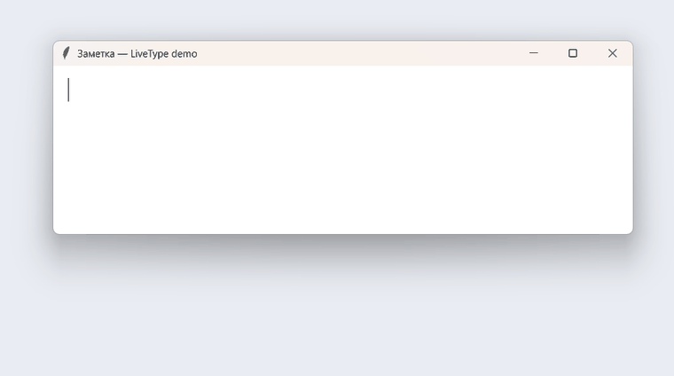
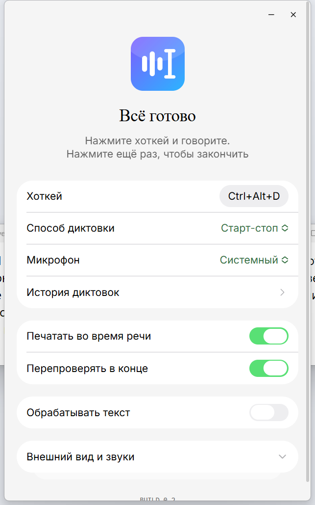

<div align="center">


# LiveType

**Offline voice typing for Windows that types while you speak.**
Words appear in any app as you talk; when you stop, the whole recording is re-checked and the text is fixed in place.

[](https://github.com/bulkozavr2000/livetype/releases/latest)
[](LICENSE)


[Русская версия →](README.ru.md)



</div>

## Why LiveType

Most dictation tools make you wait: you speak, stop, and only then the text is pasted. LiveType works like
live dictation in modern chat apps, but **in every Windows app** and **without the cloud**:

- **Types as you speak** — settled words go straight into the field (Telegram, browser, Word, Notepad, Obsidian, VS Code…); on screen there is only a small capsule.
- **Double check** — when you stop, a more accurate model re-listens to the whole recording with full context and fixes words and punctuation right in the text.
- **Keeps your edits** — fix a word by hand mid-dictation: new words still go right after the dictated text (not to the end of the document), your cursor goes back where you left it, and the final check never overwrites what you changed.
- **Private by design** — speech recognition runs on your CPU. No account, no internet after the first start, no audio leaves the PC.
- **Optional AI cleanup** — a small local language model removes filler words, fixes grammar and follows your own rules.
- **Free and open source** (MIT).

## Download & install

1. Download **LiveType-Setup-x.y.z.exe** from [Releases](https://github.com/bulkozavr2000/livetype/releases/latest) and run it.
   Windows may show "Windows protected your PC" (the installer is not code-signed): click **More info → Run anyway**.
2. On first start LiveType downloads the speech models once (~455 MB). After that it works fully offline.
3. Click into any text field, press **Ctrl+Alt+D** and speak. Press it again to finish. **Esc** cancels.

Requirements: Windows 10/11 (x64), a microphone, ~1.5 GB of disk space. No GPU needed — a 4-core laptop CPU is enough.

## Using it

| | |
|---|---|
| **Hotkey** | Ctrl+Alt+D by default; any key or combo, including a single key like Right Alt |
| **Dictation mode** | *Start–stop* (press to start, press to finish) or *Hold* (speak while holding the key) |
| **Live typing** | on/off — off means the text is inserted once at the end |
| **Re-check at the end** | second, more accurate recognition pass over the whole recording |
| **Text processing** | local AI cleanup: *Light* (563 MB) or *Accurate* (2.5 GB) model, presets: no fillers, lowercase start, final period, shorter, plus your own rules |
| **History** | your last 200 dictations, stored only on this computer (`%APPDATA%\LiveType\history.jsonl`); click to copy |

<p align="center"></p>

## How it works

```
microphone ─► Silero VAD (pauses) ─► GigaAM v3 CTC, re-run every ~0.3 s ─► words two passes agree on
                                                                              │
                                     typed into the focused field (SendInput) ◄┘
stop ─► GigaAM v3 RNNT over the whole recording (+ optional local LLM) ─► minimal in-place correction
```

- **Speech recognition:** [GigaAM v3](https://github.com/salute-developers/GigaAM) end-to-end models (Sber, MIT) — currently the strongest open model for Russian, with punctuation. Int8 ONNX via [onnx-asr](https://github.com/istupakov/onnx-asr), CPU real-time factor ≈ 0.08.
- **Streaming on a non-streaming model:** the open phrase is re-recognized every ~0.3 s; a word is typed once two consecutive guesses agree on it (LocalAgreement). Long phrases are cut exactly between words using token timestamps.
- **Typing into any app:** keyboard emulation (works with any layout). Windows UI Automation finds *your* dictated text in the field, so new words land right after it even if you clicked elsewhere, and the final correction only retypes the changed part.
- **Hotkey:** a tiny separate listener process (low-level keyboard hook), so the keyboard never lags while recognition runs.
- **Text processing:** [llama.cpp](https://github.com/ggml-org/llama.cpp) server with Qwen models (Apache-2.0), answers that differ too much from what you said are discarded.
- **Desktop UI:** Electron; the recording capsule, sounds and panel layout are adapted from the MIT-licensed Type / OpenWhispr apps.

## Languages

Russian today (GigaAM v3). The pipeline is model-agnostic: NVIDIA Parakeet / Nemotron (25+ European languages) and GigaAM Multilingual (incl. Uzbek) are the next candidates.

## FAQ

**Is there an offline dictation app for Windows that types in real time?** Yes — LiveType types words into the active app while you speak and needs no internet after the first start.

**Does it work in Telegram, browsers, Word, Obsidian, VS Code?** Yes, it types into any focused text field. Smart placement after your edits needs UI Automation, which browsers, Electron apps, Office, WPF/WinForms and Qt apps provide; elsewhere the corrected text goes to the clipboard.

**How is it different from Windows voice typing (Win+H) or cloud dictation apps?** Recognition is local and private, it keeps typing while you speak, and it re-checks the whole recording at the end to fix words and punctuation in place.

**Which speech model is used?** GigaAM v3 e2e by Sber (MIT): CTC for the live pass, RNNT for the final check.

**Does it need a GPU?** No. Everything runs on the CPU.

**Is it free?** Yes, MIT-licensed, no account, no telemetry.

## Build from source

```powershell
# engine (Python 3.12)
python -m venv .venv; .venv\Scripts\pip install -r requirements.txt
.venv\Scripts\python -m pytest tests -q
# desktop shell (Node 22+)
cd ui; npm install; npm start          # npm run mock — UI with a simulated engine
# installer -> build\release\LiveType-Setup-<version>.exe
powershell -ExecutionPolicy Bypass -File packaging\build.ps1 -Python .venv\Scripts\python.exe
```

Data (models, logs, the optional LLM runtime) lives in `%LOCALAPPDATA%\LiveType`; to keep it elsewhere set `LIVETYPE_HOME`
or write the folder path into `%APPDATA%\LiveType\home.txt`. Settings: `%APPDATA%\LiveType\config.json`.

End-to-end tests type into real windows: `tests/e2e_uia.py` (dictation into the middle of a document + user edits, WPF and Edge), `tests/e2e_ui.py` (installed app), `tests/e2e_hold.py` (Right Alt hold mode).

## Credits & license

MIT © LiveType contributors. Adapted parts come from [Type / GigaType2](https://gigatype.app) and [OpenWhispr](https://github.com/OpenWhispr/openwhispr) (MIT); models and libraries are listed in [THIRD_PARTY_NOTICES.md](THIRD_PARTY_NOTICES.md). LiveType is not affiliated with Type, OpenWhispr or Sber.
