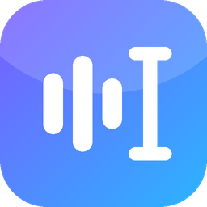
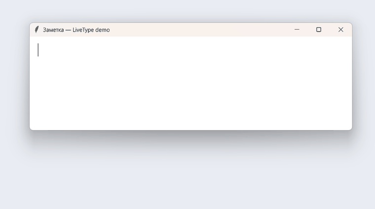
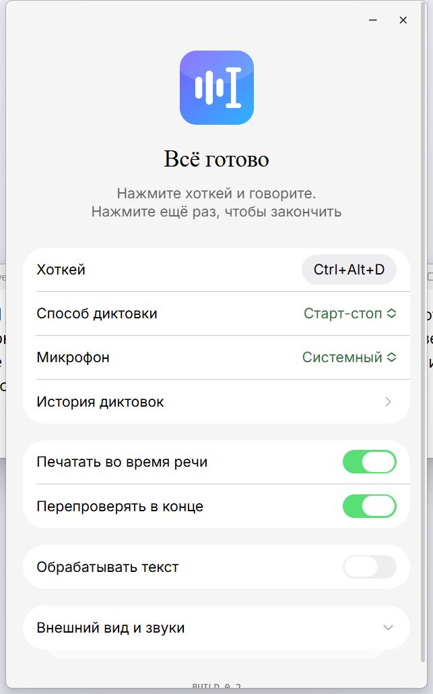

# LiveType — офлайн-диктовка для Windows

**Слова печатаются прямо во время речи — в любой программе и без интернета.**
Когда вы заканчиваете, вся запись перепроверяется, и текст исправляется на месте.

[English →](README.md)

## Чем отличается

Обычно в программах голосового ввода нужно договорить, остановиться — и только потом текст вставится.
LiveType печатает **во время речи**, как диктовка в современных чатах, но **в любом приложении Windows** и **без облака**:

- **Печать во время речи** — устоявшиеся слова сразу появляются в поле (Telegram, браузер, Word, Блокнот, Obsidian…), слово, которое ещё распознаётся, видно в маленьком пузыре.
- **Двойная проверка** — после остановки точная модель заново слушает всю запись с полным контекстом и исправляет слова и пунктуацию прямо в тексте.
- **Ваши правки не теряются** — если по ходу диктовки вы исправили слово или кликнули в другое место, новые слова всё равно идут сразу после продиктованного текста (а не в конец документа), курсор возвращается на место, а финальная проверка не трогает то, что вы изменили.
- **Приватно** — распознавание работает на процессоре вашего компьютера: без аккаунта, без интернета (после первого запуска), звук никуда не уходит.
- **Обработка текста (по желанию)** — маленькая локальная языковая модель убирает «ну» и «короче», исправляет грамматику, выполняет ваши правила.
- **Бесплатно и с открытым кодом** (MIT).

## Установка

1. Скачайте **LiveType-Setup-x.y.z.exe** со страницы [Releases](https://github.com/bulkozavr2000/livetype/releases/latest) и запустите.
   Windows может показать «Система Windows защитила ваш компьютер» (у установщика нет цифровой подписи): нажмите **Подробнее → Выполнить в любом случае**.
2. При первом запуске LiveType один раз скачает модели распознавания (~455 МБ). Дальше всё работает без интернета.
3. Кликните в любое поле, нажмите **Ctrl+Alt+D** и говорите. Ещё раз — закончить. **Esc** — отменить.

Нужно: Windows 10/11 (x64), микрофон, ~1,5 ГБ места. Видеокарта не нужна — хватает обычного ноутбука.

## Настройки

- **Хоткей** — любая клавиша или сочетание, в том числе одна клавиша, например Right Alt.
- **Способ диктовки** — «Старт-стоп» или «Удерживать хоткей».
- **Живая диктовка** — печатать во время речи; перепроверять в конце.
- **Обработка текста** — модель «Лёгкая» (563 МБ) или «Точная» (2,5 ГБ), правила: «Без «ну» и «короче»», «С маленькой буквы», «Точка в конце», «Писать коротко», свои пожелания.
- **История диктовок** — последние 200, хранятся только на вашем компьютере (`%APPDATA%\LiveType\history.jsonl`); **внешний вид и звуки**.

## Как устроено

- Распознавание — **GigaAM v3** (Сбер, MIT), лучшая открытая модель для русского языка, сразу с пунктуацией: быстрая CTC-версия во время речи, точная RNNT для финальной проверки. Паузы — Silero VAD.
- Текущая фраза распознаётся заново каждые ~0,3 с; слово печатается, когда две попытки подряд с ним согласны.
- Печать — эмуляция клавиатуры (любая раскладка); «свой» текст в поле находится через UI Automation Windows.
- Обработка текста — llama.cpp + модели Qwen (Apache-2.0).
- Интерфейс — Electron; капсула записи, звуки и панель адаптированы из приложений Type / OpenWhispr (MIT).

## Частые вопросы

**Есть ли офлайн-диктовка для Windows, которая печатает в реальном времени?** Да — LiveType печатает слова в активное окно прямо во время речи и после первого запуска работает без интернета.

**Работает в Telegram, браузере, Word?** Да, в любом поле для текста.

**Какой язык?** Сейчас русский. Следующие кандидаты — модели NVIDIA для европейских языков и GigaAM Multilingual (в том числе узбекский).

**Это бесплатно?** Да, лицензия MIT, без аккаунта и без телеметрии.

## Лицензия

MIT © LiveType contributors. Использованные части Type / GigaType2 и OpenWhispr (MIT), модели и библиотеки — в [THIRD_PARTY_NOTICES.md](THIRD_PARTY_NOTICES.md). LiveType не связан с Type, OpenWhispr и Сбером.
